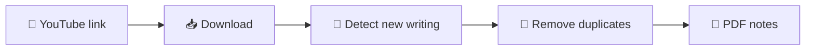

<div align="center">

# 🎓 Video2Notes

### Turn any YouTube lecture into clean PDF notes. Automatically.

*Stop pausing, screenshotting, and pausing again. Let the computer do the boring part.*

[](https://github.com/scatterfah/Video2Notes/releases/latest)


### 🧠 Human brain + 🤖 AI = Video2Notes
**Made by [Fahad](https://github.com/scatterfah)** 👨‍💻

</div>

---

## ✨ What does it do?

You paste a YouTube link. Video2Notes watches the lecture for you and:

1. 📥 **Downloads** the video in the best quality it can find
2. 👀 **Watches the whiteboard** and notices when new writing appears
3. 🧹 **Throws away duplicates**, so one equation written over 40 seconds does not become 40 almost-identical pictures
4. 📄 **Builds one PDF**, one page per meaningful stage of the explanation



## 🚀 Download (Windows)

1. Go to the **[Releases page](https://github.com/scatterfah/Video2Notes/releases/latest)**
2. Download **`Video2Notes-Setup.exe`** and run it
3. Open **Video2Notes** from the Start menu or the desktop icon

That's it. **Nothing else to install.** FFmpeg and everything else are already inside.

> ⚠️ **Windows may warn you.** The app is not digitally signed yet (signing costs money or needs approval). If you see *"Windows protected your PC"*, click **More info → Run anyway**. On some computers, **Smart App Control** blocks unsigned apps completely. Getting the app signed is on the to-do list.

## 🎛️ How to use it

1. Paste a YouTube link
2. Pick a **detail level**
3. Press **Start** and watch the progress bar fill up
4. Press **Open PDF** 🎉

| Detail level | What you get |
|---|---|
| 📘 One page per finished board | Only the finished version of each board |
| ⚖️ Balanced *(recommended)* | Up to about 4 stages per board |
| 🔍 Detailed | Up to about 10 stages per board |

📁 Your files are saved in `Documents\WhiteboardExtractor\extracted_notes\<video id>\`.
Screenshots removed as duplicates are moved to a `skipped` folder there. **Nothing is ever deleted**, so you can rescue any page.

## 🤝 Built by a human and an AI

This project is a team effort, and we are not shy about it:

| | Who | What they did |
|---|---|---|
| 🧠 | **[Fahad](https://github.com/scatterfah)** (human) | Had the idea, decided what the app should do, tested everything on real computers, and kept asking *"why is it so slow?"* until it got faster |
| 🤖 | **Claude** (AI, made by [Anthropic](https://www.anthropic.com)) | Wrote most of the code, explained things step by step, and apologised for its own bugs |

The human brought the problem and the taste. The AI brought the typing speed. Neither could have built it alone, and neither would have enjoyed debugging video codecs by themselves. 😄

## ⚠️ Honest limitations

No tool is perfect, and this one is no exception:

- 🎥 It looks for **changes on the screen**, so it works best on handwriting on a plain board. A webcam picture of the teacher, a moving hand, or scrolling can cause extra pages.
- 🖍️ Very faint or yellow writing on a white board may not be detected.
- ✅ Always check the PDF (and the `skipped` folder) when the notes are important.

## 🛠️ Run from source

You need Python 3.10 or newer, plus [FFmpeg](https://ffmpeg.org) and [Deno](https://deno.com) in your PATH.

```bash
git clone https://github.com/scatterfah/Video2Notes.git
cd Video2Notes
python3 -m venv .venv
source .venv/bin/activate        # Windows: .venv\Scripts\activate
pip install -r requirements.txt
python app.py
```

On Linux you may also need tkinter (Fedora: `sudo dnf install python3-tkinter`).

## 🐛 Found a bug? Have an idea?

Open an [issue](https://github.com/scatterfah/Video2Notes/issues). If it helps you study, a ⭐ on the repo makes the human very happy.

## ⚖️ Legal

Use this tool for **personal study**. Downloading videos may be against the terms of the video platform, and the videos belong to their creators, so please respect their rights. This project is not affiliated with YouTube or Google.

## 📜 License

MIT. See [LICENSE](LICENSE). Bundled third-party software is listed in [THIRD_PARTY_NOTICES.md](THIRD_PARTY_NOTICES.md).

<div align="center">

Made with 🧠 + 🤖 by **[Fahad](https://github.com/scatterfah)**

</div>
